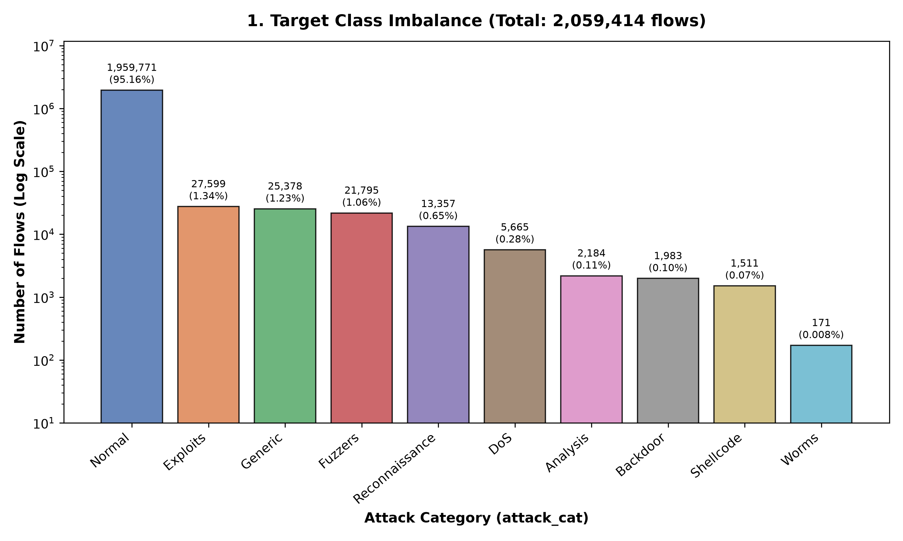
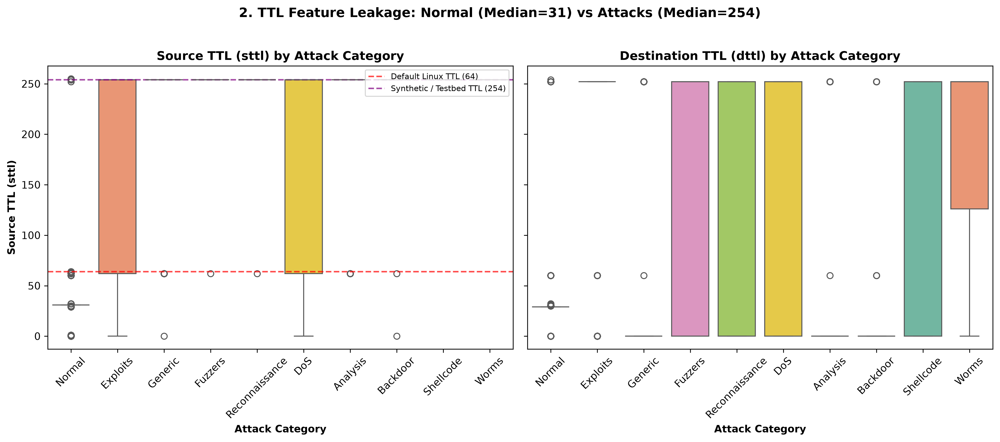
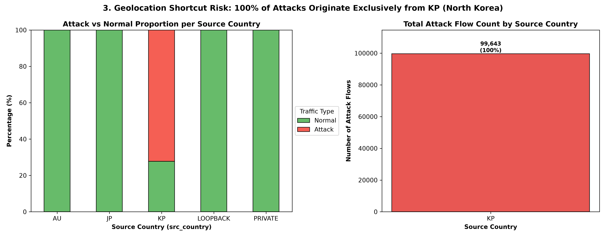
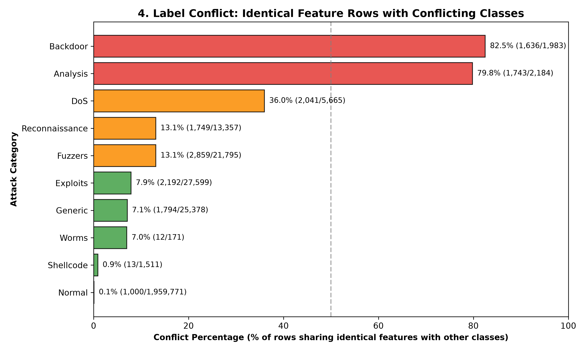
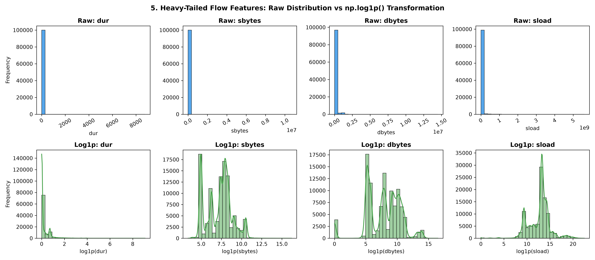
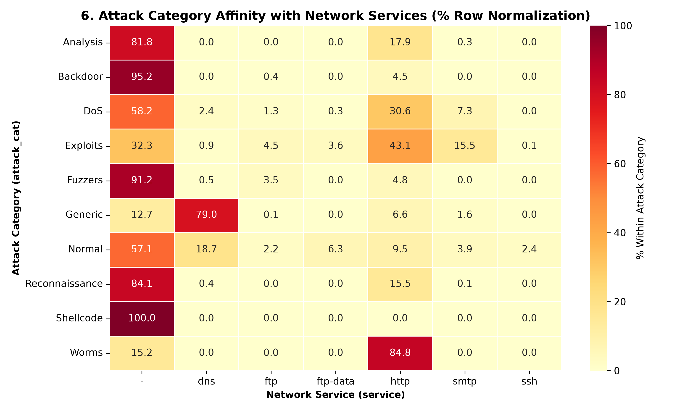
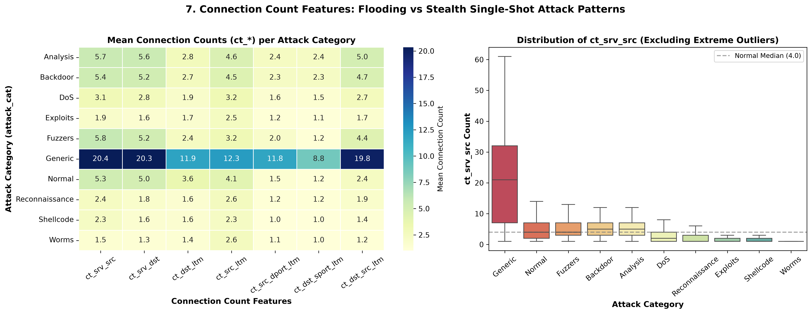

# รายงานผลการสำรวจข้อมูล (Exploratory Data Analysis — Progress 3)

**ผู้จัดทำ:** Art (`branch: Art`)  
**ชุดข้อมูล:** `data/processed/features.parquet`  
**จำนวนข้อมูลทั้งหมด:** 2,059,414 แถว, 54 คอลัมน์  
**คลาสเป้าหมาย:** `attack_cat` (10 คลาส: Normal + 9 ประเภทการโจมตี)  
**ตำแหน่งรูปภาพ:** `reports/figures/Art/`  

---

## บทสรุปภาพรวม (Executive Summary)

การทำ EDA ใน Progress 3 นี้ มีเป้าหมายสำคัญตามโจทย์คือ **"เห็นอะไรในข้อมูล $\rightarrow$ นำไปสู่การตัดสินใจ / เข้าใจอะไรในการเทรนโมเดล (Progress 4)"**

จากการสำรวจข้อมูลอย่างละเอียดพบข้อค้นพบเชิงลึก 6 ประการหลัก:
1. **Target Class Imbalance รุนแรงมาก:** คลาส Normal มีสัดส่วนสูงถึง 95.16% ขณะที่การโจมตีบางกลุ่ม เช่น Worms มีเพียง 171 แถว (0.008%)
2. **TTL Data Leakage:** ค่า `sttl` และ `dttl` แยกคลาสการโจมตีออกจาก Normal ได้เกือบสมบูรณ์แบบ เกิดจากการตั้งค่าสภาพแวดล้อมจำลอง (Testbed Artifact)
3. **Geolocation & ASN Shortcut Learning Risk:** การโจมตีทั้งหมด 100% (99,643 แถว) มาจากประเทศ `KP` (North Korea) และ ASN 131279 หากนำ Geo ไปเทรนตรงๆ จะเกิดการจำทางลัด (Spurious Correlation)
4. **Label Conflicts สูงมากในบางคลาส:** เมื่อตัด IP และ Timestamp ออก พบว่า Backdoor มีฟีเจอร์ซ้ำซ้อนกับคลาสอื่นถึง 82.5% และ Analysis ซ้ำซ้อน 79.8%
5. **Heavy-Tailed Distributions & Outliers:** ฟีเจอร์โฟลว์ (`sbytes`, `dbytes`, `sload`, `dur`) มีความเบ้ขวาอย่างยิ่งยวด จำเป็นต้องใช้ Log Transformation (`np.log1p`)
6. **Protocol & Service Specificity:** การโจมตีแต่ละประเภทมีความสัมพันธ์กับ Service และ Protocol ชัดเจน เช่น Generic กระจุกตัวที่ DNS, Exploits และ Worms กระจุกตัวที่ HTTP
7. **Connection Count Patterns (`ct_*`):** ฟีเจอร์การนับการเชื่อมต่อเผยรูปแบบ Flooding vs Stealth Single-shot อย่างชัดเจน โดยเฉพาะ Generic ที่มีความหนาแน่นสูงกว่าปกติ 4-8 เท่า

---

## 1. การกระจายตัวของคลาสเป้าหมายและความไม่สมดุล (Target Class Imbalance)

### สถิติที่พบ:
- **Normal:** 1,959,771 แถว (95.16%)
- **Exploits:** 27,599 แถว (1.34%)
- **Generic:** 25,378 แถว (1.23%)
- **Fuzzers:** 21,795 แถว (1.06%)
- **Reconnaissance:** 13,357 แถว (0.65%)
- **DoS:** 5,665 แถว (0.27%)
- **Analysis:** 2,184 แถว (0.11%)
- **Backdoor:** 1,983 แถว (0.10%)
- **Shellcode:** 1,511 แถว (0.07%)
- **Worms:** 171 แถว (0.008%)

### สิ่งที่เห็น $\rightarrow$ การตัดสินใจสำหรับโมเดล:
- **เห็นอะไร:** ข้อมูลมีอัตราส่วนระหว่างคลาสหลัก (Normal) กับคลาสน้อยสุด (Worms) ห่างกันกว่า **11,460 เท่า** ถือเป็น Extreme Class Imbalance
- **การตัดสินใจเชิงเทคนิค:**
  1. **Evaluation Metric:** เราจะใช้ **Macro-averaged F1-Score** และ **PR-AUC (Precision-Recall AUC)** เป็นตัวชี้วัดหลัก เพราะถ้าใช้ Accuracy โมเดลแค่ทายว่า Normal ก็ถูก 95.16% แล้ว
  2. **Cross-Validation:** เราจะใช้เทคนิค **Stratified K-Fold Cross-Validation** มาใช้ในการแบ่ง Train / Validation / Test Sets เพื่อให้สัดส่วนเปอร์เซ็นต์ของทุกคลาสในแต่ละ Fold ให้ตรงกับความเป็นจริง และป้องกันความเสี่ยงที่คลาสขนาดเล็กอย่าง Worms จะหลุดหายหรือกระจุกตัวอยู่ใน Fold ใด Fold หนึ่งจนโมเดลไม่สามารถประเมินผลได้
  3. **Cost-Sensitive Learning:** 
    **Class Weighting:** เราจะกำหนดค่า **น้ำหนักโทษ (Loss Penalty)** แบบ **ผกผันกับจำนวนตัวอย่าง (Inverse Frequency Weighting)** ให้กับอัลกอริทึมที่จะใช้ ทำให้เมื่อโมเดลทายคลาสหายากแบบ worm จะโดนบทลงโทษรุนแรงกว่าการทาย normal ผิด
    **Advanced Loss Functions:** เราจะพิจารณาปรับใช้ **Focal Loss** เพื่อลดค่าน้ำหนักของตัวอย่างที่โมเดลทายถูกได้ง่าย เช่น Normal และบังคับให้อัลกอริทึมไปโฟกัสการจำแนกตัวอย่างที่ยากและมีความสำคัญสูง เช่น shellcode ในระหว่างการเทรน

---

## 2. การรั่วไหลของฟีเจอร์ TTL (TTL Leakage Verification)

### สถิติที่พบ:
- **Normal:** Mean ของ `sttl` อยู่ที่ 34.87 โดย Median อยู่ที่ 31.0
- **Shellcode:** 100% ของตัวอย่างทั้งหมด (1,511 แถว) มีค่า `sttl` เท่ากับ **254.0 พอดี** (Standard Deviation = 0.00)
- **Fuzzers, Generic, Reconnaissance, Worms:** มีค่ามัธยฐานของ `sttl` เท่ากับ 254.0

### สิ่งที่เห็น $\rightarrow$ การตัดสินใจสำหรับโมเดล:
- **เห็นอะไร:** เราตรวจพบ **Data Leakage** รุนแรงในฟีเจอร์กลุ่ม TTL (sttl, dttl, ct_state_ttl) ซึ่งเกิดจากสภาพแวดล้อมการจำลองข้อมูลด้วยอุปกรณ์ในห้องแล็บ หากไม่จัดการปัญหานี้ โมเดลจะเกิดภาวะ Shortcut Learning
- **การตัดสินใจเชิงเทคนิค:**
  1. **หลีกเลี่ยงการพึ่งพา TTL เพียงลำพัง:** หากใส่ `sttl`, `dttl`, `ct_state_ttl` โมเดล Decision Tree จะใช้ฟีเจอร์นี้เป็น Root Split ทำให้คะแนนสูงเกินจริง แต่ใช้งานจริงกับระบบภายนอกไม่ได้ผล
  2. **Ablation Study ใน Progress 4:** ต้องสร้างการทดลองเปรียบเทียบระหว่าง **Model (Without TTL)**(โมเดลที่ให้จริง) และ **Model (With TTL)**(ที่จะใช้เป็น Baseline) เพื่อรายงาน Data Leakage Gap ชัดเจน

---

## 3. ความเสี่ยงการเรียนรู้ทางลัดจาก Geolocation (Geo Shortcut Risk)

### สถิติที่พบ:
- **AU (Australia):** 23,170 แถว เป็น Normal ทั้งหมด (0 Attacks)
- **JP (Japan):** 1,887,832 แถว เป็น Normal ทั้งหมด (0 Attacks)
- **KP (North Korea - 175.45.176.0/24):** มีทราฟฟิกรวม 138,033 แถว โดยมี **99,643 แถวเป็นการโจมตี (คิดเป็น 100.0% ของการโจมตีทั้งหมดในดาต้าเซ็ต)**
- **Private & Loopback:** เป็น Normal ทั้งหมด (0 Attacks)

### สิ่งที่เห็น $\rightarrow$ การตัดสินใจสำหรับโมเดล:
- **เห็นอะไร:** UNSW-NB15 มี IP เพียง 49 ตัว และการโจมตีทุกประเภทในชุดข้อมูลถูกปล่อยมาจาก IP ช่วง `175.45.176.0/24` ซึ่งถูกจับคู่เข้ากับประเทศ `KP` และ ASN 131279
- **การตัดสินใจเชิงเทคนิค:**
  1. **Spurious Correlation:** หากป้อน `src_country` หรือ `src_asn` ให้โมเดล โมเดลจะจดจำทางลัดว่า `src_country == 'KP' -> Attack` โดยไม่เรียนรู้พฤติกรรมของทราฟฟิกจริง
  2. **Model Experiment Design:** ออกแบบชุดโมเดลเป็น **Base Model (Traffic features only)** และ **Base + Geo Model** เพื่อวิเคราะห์ว่า Geo ช่วยเสริมหรือทำให้เกิด Overfitting ต่อชุด IP จำกัด

---

## 4. ปัญหาความกำกวมของฟีเจอร์และเพดานทางทฤษฎี (Label Conflicts Analysis)

### สถิติที่พบ (จาก `reports/label_conflicts.csv`):
- **Backdoor:** ข้อมูล **82.5%** (1,636 จาก 1,983 แถว) มีค่าฟีเจอร์เหมือนกับคลาสอื่นทุกตัวแปร
- **Analysis:** ข้อมูล **79.8%** (1,743 จาก 2,184 แถว) มีค่าฟีเจอร์ซ้ำซ้อนกับคลาสอื่น
- **DoS:** มีความซ้ำซ้อน **36.0%** (2,041 จาก 5,665 แถว)
- **Shellcode:** มีความซ้ำซ้อนเพียง 0.9%
- **Normal:** มีความซ้ำซ้อนเพียง 0.1%

### สิ่งที่เห็น $\rightarrow$ การตัดสินใจสำหรับโมเดล:
- **เห็นอะไร:** ทราฟฟิกประเภท Backdoor และ Analysis เมื่อตัด IP และเวลาออก จะมีแพ็กเก็ตไซส์และสถิติการเชื่อมต่อเหมือนกับทราฟฟิกปกติและทราฟฟิกอื่นๆ แทบจะ 100%
- **การตัดสินใจเชิงเทคนิค:**
  1. **Theoretical Performance Ceiling:** เข้าใจข้อจำกัดว่าทำไมโมเดล Machine Learning ถึงทำ Recall ของ Backdoor และ Analysis ได้ต่ำ โดยไม่ได้เป็นเพราะความผิดพลาดของโมเดล แต่เป็นเพราะข้อจำกัดทางสถิติของข้อมูล (Bayes Error Rate)
  2. **ไม่ Overfit พารามิเตอร์:** หลีกเลี่ยงการดันน้ำหนักของ Backdoor/Analysis สูงเกินไป เพราะจะดึงให้ Normal ถูกทำนายผิด (False Positive สูงขึ้น)

---

## 5. การกระจายตัวแบบหางยาวของฟีเจอร์โฟลว์ (Numerical Skewness & Log Transforms)

### สถิติที่พบ:
- `dur` (Duration): มัธยฐาน = 0.026s, ค่า 75% = 0.334s แต่ค่าสูงสุด = 8,786.6s (~2.4 ชั่วโมง)
- `sbytes` (Source Bytes): มัธยฐาน = 1,684 ไบต์ แต่ค่าสูงสุด = 14,355,770 ไบต์
- `sload` (Source Load): มัธยฐาน = 540,740 แต่ค่าสูงสุด = 5,988,000,000

### สิ่งที่เห็น $\rightarrow$ การตัดสินใจสำหรับโมเดล:
- **เห็นอะไร:** ฟีเจอร์เชิงปริมาณมีการกระจายตัวแบบ Heavy-tailed (Power-law distribution) โดยมีความเบ้ขวา (Skewness) และ Extreme Outliers สูงมาก
- **การตัดสินใจเชิงเทคนิค:**
  1. **Feature Transformation:** ต้องทำ **`np.log1p()` transformation** สำหรับฟีเจอร์ปริมาณ (`sbytes`, `dbytes`, `sload`, `dload`, `dur`) ก่อนนำไปเทรน โดยเฉพาะโมเดลประเภท Neural Network และ Linear/Distance-based models
  2. **Robust Scaler:** ควรใช้ `RobustScaler` (อิง Median & IQR) แทน `StandardScaler` ทั่วไปเพื่อลดผลกระทบจากค่าผิดปกติ

---

## 6. ความจำเพาะของโปรโตคอลและเซอร์วิส (Protocol & Service Affinity)

### สถิติที่พบ:
- **Generic:** 78.6% เกิดขึ้นบน service `dns`
- **Exploits:** 40.8% เกิดขึ้นบน service `http`
- **Worms:** 84.8% เกิดขึ้นบน service `http`
- **Analysis & Backdoor:** เกิดขึ้นบน protocol `unas` (Unassigned / Protocol 0) ในสัดส่วนสูงที่สุด
- **Service `-` (Non-standard):** มีมากกว่า 50% ของทราฟฟิกทั้งหมด

### สิ่งที่เห็น $\rightarrow$ การตัดสินใจสำหรับโมเดล:
- **เห็นอะไร:** หมวดหมู่การโจมตีมีความผูกพันกับบริการอย่างมีนัยสำคัญ แต่ค่า `-` ใน `service` มีสัดส่วนสูงมาก
- **การตัดสินใจเชิงเทคนิค:**
  1. **Missing / Dash Handling:** ห้ามตัดหรือแทนที่ `-` เป็น Null ให้ปฏิบัติกับ `-` เป็นหมวดหมู่ `"unknown/non-standard"` เพราะทราฟฟิกที่ไม่ระบุพอร์ตมาตรฐานเป็นพฤติกรรมบ่งชี้สำคัญของการโจมตีหลายชนิด
  2. **Encoding Strategy:** สำหรับ `proto` และ `service` ให้ใช้ One-Hot Encoding สำหรับ Top Categories (เช่น http, dns, ftp, smtp) และจัดกลุ่มค่าความถี่ต่ำที่เหลือเป็นกลุ่ม `"other"` เพื่อป้องกัน Curse of Dimensionality

---

## 7. พฤติกรรมการนับการเชื่อมต่อและความถี่ทราฟฟิก (Connection Count Patterns: `ct_*`)

### สถิติที่พบ:
- **Generic (พฤติกรรม Flooding):** มีค่าการเชื่อมต่อซ้ำๆ สูงผิดปกติในทุกมิติ
  - `ct_srv_src` (การเชื่อมต่อ service เดียวกันจาก IP ต้นทางเดิม): ค่าเฉลี่ยสูงถึง **20.4 ครั้ง** (มัธยฐาน = 20.0) เทียบกับ Normal ที่เฉลี่ยเพียง 5.3 ครั้ง (มัธยฐาน = 4.0)
  - `ct_dst_src_ltm` (การเชื่อมต่อคู่ IP เดิมซ้ำๆ ใน 100 การเชื่อมต่อล่าสุด): ค่าเฉลี่ยสูงถึง **19.8 ครั้ง** (มัธยฐาน = 20.0) เทียบกับ Normal ที่มีเพียง 2.4 ครั้ง (มัธยฐาน = 2.0)
  - `ct_dst_sport_ltm`: สูงถึง **8.8 ครั้ง** เทียบกับ Normal เพียง 1.2 ครั้ง
- **Shellcode, Worms, Exploits (พฤติกรรม Stealth / Single-Shot):**
  - **Shellcode:** มีค่า `ct_dst_sport_ltm` เท่ากับ **1.000000 ทุกแถว 100%** (ไม่เคยเชื่อมต่อซ้ำพอร์ตต้นทางเดิมเลย เป็นการยิงคำสั่งบรรทัดเดียวจบ)
  - **Worms:** มีค่าเฉลี่ย `ct_dst_sport_ltm` เท่ากับ 1.02 และ `ct_srv_src` มัธยฐานเท่ากับ 1.0
  - **Normal (ทราฟฟิกปกติ):** มีค่าการเชื่อมต่อเฉลี่ยในระดับปานกลาง (2 - 5 ครั้ง) ตามพฤติกรรมการเปิดใช้งานเว็บเบราว์เซอร์หรือแอปพลิเคชันทั่วไป

### สิ่งที่เห็น $\rightarrow$ การตัดสินใจสำหรับโมเดล:
- **เห็นอะไร:** ฟีเจอร์กลุ่ม `ct_*` สะท้อน **"พฤติกรรมความถี่การส่ง (Connection Density & Footprint)"** ได้อย่างชัดเจน โดยแบ่งทราฟฟิกออกเป็น 2 ขั้วตรงข้าม:
  1. *Flooding Attacks (Generic / DoS):* รัวการเชื่อมต่อไปยังเป้าหมายและบริการเดิมซ้ำๆ จนค่า `ct_*` ทะลุเกณฑ์ปกติ 4 - 8 เท่า
  2. *Stealth Attacks (Shellcode / Worms):* ใช้การเชื่อมต่อแบบ Single-shot เพื่อหลบเลี่ยงการตรวจจับ ทำให้ค่า `ct_*` คงที่อยู่ที่ 1 แทบทั้งหมด
- **การตัดสินใจเชิงเทคนิค:**
  1. **Core Behavioral Features:** ฟีเจอร์กลุ่ม `ct_*` ถือเป็นฟีเจอร์พฤติกรรมที่สะอาด ปราศจาก Data Leakage (ไม่เหมือน TTL) และไม่ขึ้นกับหมายเลข IP (ไม่ติด Geo Shortcut) จึงควรเก็บไว้เป็น **ฟีเจอร์หลัก (Core Base Features)** ใน Progress 4
  2. **Key Discriminator for Generic:** โมเดลจะสามารถใช้ `ct_srv_src > 10` ร่วมกับ `service == 'dns'` เพื่อแยกแยะคลาส Generic ออกจาก Normal และ DoS ได้อย่างแม่นยำสูง

---

## ตารางสรุปการตัดสินใจเตรียมโมเดลสำหรับ Progress 4

| มิติการวิเคราะห์ | ข้อค้นพบจาก EDA | แผนการจัดการใน Progress 4 |
| :--- | :--- | :--- |
| **Target** | Normal 95.16% vs Worms 0.008% | ใช้ Stratified K-Fold, Macro-F1 / PR-AUC, Balanced Class Weight |
| **TTL Features** | `sttl` 254 ใน Attack vs 31 ใน Normal (Leakage) | ทำการทดลองแยกระหว่าง With TTL และ Without TTL เพื่อวัด Leakage Gap |
| **Geo Features** | การโจมตี 100% มาจาก KP (175.45.176.0/24) | ทำการทดลอง Base Model vs Base+Geo Model เพื่อประเมิน Shortcut Learning |
| **Label Conflicts** | Backdoor ซ้ำ 82.5%, Analysis ซ้ำ 79.8% | รับทราบ Theoretical Ceiling ไม่ดันพารามิเตอร์จนเกิด False Positive สูง |
| **Flow Features** | `sbytes`, `dur`, `sload` เบ้ขวาสูงมาก | ใช้ `np.log1p()` transformation และ `RobustScaler` |
| **Categorical** | `service == '-'` สูง, Generic ผูกกับ DNS | จัด `-` เป็นหมวดหมู่ non-standard และทำ Grouping rare categories |
| **Connection Counts (`ct_*`)** | Generic สูงผิดปกติ (20.4 vs 5.3) ส่วน Shellcode เป็น Single-shot (1.0) | ใช้เป็นฟีเจอร์หลัก (Core Features) ในการแยกคลาส Flooding และ Stealth ออกจาก Normal |

